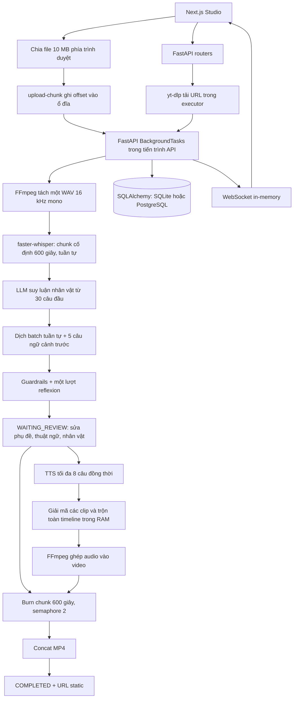

# Đánh giá OneFL: toàn bộ luồng ứng dụng và backend

Ngày đánh giá: **21/10/2026**. Đối tượng: working tree hiện tại, bao gồm thay đổi chưa commit của người dùng.

**Kết luận: backend hiện là một ứng dụng chạy trên một máy với nhiều thành phần có thể dùng được, nhưng còn lỗi chức năng và lỗi toàn vẹn dữ liệu nghiêm trọng. Chưa có cơ sở xác nhận sẵn sàng production hoặc đáp ứng ổn định video 10 giờ/50 GB.** Ghi chú “Production Enterprise 100%, không còn lỗi” trong sổ phiên cũ không phù hợp với kết quả kiểm chứng lần này.

Không sửa mã ứng dụng, không chạy lại dự án video thật, không gọi dịch vụ AI tính phí. Các script tái hiện dùng DB SQLite trong RAM, media giả và mock provider/subprocess.

## 1. Phạm vi và phương pháp

Áp dụng skill tại thư mục dự án: [code-review-excellence](/D:/OneFl/.agents/skills/code-review-excellence/SKILL.md), [backend-architect](/D:/OneFl/.agents/skills/backend-architect/SKILL.md), [concise-planning](/D:/OneFl/.agents/skills/concise-planning/SKILL.md), [verification-before-completion](/D:/OneFl/.agents/skills/verification-before-completion/SKILL.md), [windows-shell-reliability](/D:/OneFl/.agents/skills/windows-shell-reliability/SKILL.md). Đọc thêm hướng dẫn [lint-and-validate](/D:/OneFl/.agents/skills/lint-and-validate/SKILL.md) cho các script kiểm chứng.

Đọc các module backend, model/schema, API, Agent và logic frontend gọi API/nhận sự kiện; đối chiếu [kiến trúc](/D:/OneFl/Architecture.md), [đặc tả dịch](/D:/OneFl/Translation_Engine_Specification.md), cấu hình triển khai và test. Kiểm kê **96 tệp** mã nguồn/cấu hình/tài liệu tham chiếu trong [inventory có SHA-256](/D:/OneFl/docs/reviews/2026-10-21-source-inventory.json). Đây là đánh giá mã ứng dụng của dự án; không coi dependency trong môi trường ảo, node_modules, build output hay media là mã cần review từng dòng.

Mức độ:

- **P1:** cần sửa trước khi dựa vào kết quả xử lý hoặc triển khai cho người dùng khác; có thể chặn chức năng, gây sai/mất nội dung hoặc gây quá tải.
- **P2:** hành vi sai có điều kiện, contract không khớp, vận hành/khôi phục chưa đáng tin.
- **P3:** cải thiện chất lượng, khả năng bảo trì và quan sát.

Nhãn **Tái hiện** nghĩa là đã chạy kiểm tra cô lập. Nhãn **Đọc code** là kết luận từ đường thực thi; chưa đo bằng video thật hoặc môi trường production.

## 2. Luồng thực tế



Lồng tiếng là nhánh người dùng kích hoạt riêng; pipeline dịch dừng ở WAITING_REVIEW. Agent API là nhánh công cụ riêng, chưa điều phối đầy đủ pipeline video này.

| Yêu cầu trong thiết kế | Code hiện tại | Đánh giá |
|---|---|---|
| Upload trực tiếp S3/Tus, resumable | Frontend chia 10 MB; backend ghi local theo offset | Có streaming nhưng chưa có phiên upload/manifest/resume thực sự |
| VAD chia theo khoảng lặng | ASR cắt cố định mỗi 600 giây | Có giới hạn kích thước audio; có thể cắt giữa lời thoại |
| WhisperX alignment và diarization | faster-whisper; đổi SPEAKER_00/01 khi khoảng nghỉ >1,5 giây | Chưa có nhận diện người nói thực hay alignment theo từ |
| Worker pool, Temporal, retry/checkpoint | BackgroundTasks, executor, subprocess cục bộ | Chưa có điều phối bền vững |
| Redis Pub/Sub cho tiến độ | Dict socket trong một process | Không đồng bộ giữa các process/replica |
| Render phân tán | Hai tác vụ burn cục bộ trong cùng API | Có chia chunk; chưa có worker phân tán/checkpoint chunk |
| Video-grounded translation | Prompt có hướng dẫn thị giác; pipeline gửi text | Chưa có trích frame/phân tích hình ảnh trong luồng dịch chính |
| Chất lượng dịch được benchmark | Guardrails chạy trên ground truth mẫu | Chưa đo chất lượng ASR/dịch từ media thực |

## 3. Các lỗi P1 cần ưu tiên

### F01 — Burn video gốc thất bại vì thiếu import cấu hình

**Tái hiện.** [workflow_engine.py:389](/D:/OneFl/backend/app/services/workflow_engine.py:389) dùng `settings.OUTPUT_DIR` nhưng module không import `settings`. Khi chưa có dubbed_video_path hợp lệ, biểu thức này chạy trước nhánh chọn video gốc và đưa dự án sang FAILED: **`name 'settings' is not defined`**.

Thêm import là cần thiết nhưng chưa đủ: đường burn còn F02, F06 và F09 bên dưới. Tiêu chí sửa: burn video gốc có subtitle phải tạo video hợp lệ và không phát sinh lỗi session.

### F02 — Hai chunk burn dùng chung AsyncSession và commit đồng thời

**Tái hiện.** [workflow_engine.py:435](/D:/OneFl/backend/app/services/workflow_engine.py:435) gọi `await db.commit()` từ mỗi `process_chunk`; [dòng 486](/D:/OneFl/backend/app/services/workflow_engine.py:486) chạy chúng bằng gather. Một AsyncSession dùng chung không quản lý được hai transaction đồng thời.

Probe 2 chunk trả **IllegalStateChangeError**, kể cả sau khi cấp biến `settings` còn thiếu chỉ trong bộ nhớ kiểm thử. Nhánh catch lại commit trên session lỗi mà không rollback nên việc ghi FAILED cũng có thể hỏng.

Sửa bằng một nơi ghi tiến độ tuần tự hoặc session riêng theo đơn vị công việc; xử lý rollback trước khi ghi trạng thái lỗi. Tiến độ phải dựa vào số chunk hoàn thành, thay vì index chunk vừa bắt đầu.

### F03 — Lỗi ASR tạo ra câu thoại không có trong video

**Tái hiện.** [asr_service.py:187](/D:/OneFl/backend/app/services/asr_service.py:187) trả hai câu demo tiếng Trung khi suy luận lỗi hoặc không thu được cues. Probe ép model loading lỗi vẫn nhận được hai câu bắt đầu bằng “大家早上好…”.

Người dùng có thể nhận bản dịch/lồng tiếng của nội dung mẫu thay cho video của họ. Video không có lời nói cũng có thể đi vào fallback này. File audio thiếu/empty lại trả `[]`, nên trạng thái rỗng và trạng thái lỗi chưa được phân biệt.

Sửa bằng lỗi có phân loại và fail stage rõ ràng; nội dung demo chỉ dùng trong fixture/chế độ demo tách biệt. [audio_service.py:42](/D:/OneFl/backend/app/services/audio_service.py:42) cũng cần raise khi FFmpeg tách audio thất bại và xác minh file đầu ra.

### F04 — Provider dịch lỗi nhưng kết quả vẫn được chấp nhận là bản dịch

**Tái hiện.** [translation_service.py:114](/D:/OneFl/backend/app/services/translation_service.py:114) đổi lỗi LLM thành JSON chứa nguyên văn nguồn. [dòng 177](/D:/OneFl/backend/app/services/translation_service.py:177) tiếp tục dùng nguyên văn khi thiếu kết quả; [dòng 188](/D:/OneFl/backend/app/services/translation_service.py:188) luôn đặt `has_guardrail_violation=False`.

Probe ép provider offline: `Hello` trở thành translated_text=`Hello`, violation=false. Pipeline có thể xuất phụ đề/lồng tiếng rồi WAITING_REVIEW mà người dùng không thấy việc dịch đã thất bại. Các cờ vi phạm cũng chưa được workflow ghi xuống DB.

Sửa bằng trạng thái FAILED/PARTIAL cho batch chưa dịch, giữ nguyên nguồn trong trường nguồn, ghi lỗi/cờ QC thực và chỉ đánh dấu hoàn thành khi đủ cues đạt điều kiện.

### F05 — Auto-wrap cắt bỏ nội dung thay vì chỉ ngắt dòng

**Tái hiện.** [guardrails.py:60](/D:/OneFl/backend/app/services/guardrails.py:60) trả `wrapped_lines[:max_lines]`. Toàn bộ từ sau hai dòng bị bỏ trước khi kiểm tra chất lượng.

Probe đưa **40 từ**, nhận **16 từ** và **valid=true, violations=[]**. Đây là mất nội dung âm thầm, không phải phép tóm tắt có kiểm soát. Cần giữ đủ văn bản, báo vượt giới hạn và yêu cầu rút gọn có kiểm chứng hoặc chia cue.

### F06 — Duration video bị thay bằng thời điểm kết thúc câu thoại cuối

**Tái hiện việc ghi sai metadata; hệ quả cắt video đọc từ code.** [workflow_engine.py:116](/D:/OneFl/backend/app/services/workflow_engine.py:116) ghi `raw_cues[-1]['end_time']` vào video_duration_seconds. Probe video metadata 12 giây với câu cuối kết thúc ở 4 giây: duration bị đổi thành 4 giây và pipeline vẫn WAITING_REVIEW.

Burn chia chunk theo duration này tại [dòng 415](/D:/OneFl/backend/app/services/workflow_engine.py:415), nên phần video im lặng/credits sau lời thoại cuối không nằm trong phạm vi render. Cần lấy duration từ probe media và lưu transcript coverage riêng.

### F07 — Trộn lồng tiếng không đáp ứng bộ nhớ có giới hạn cho video 10 giờ

**Đọc code và tính kích thước; chưa đo peak RAM thực.** [tts_service.py:762](/D:/OneFl/backend/app/services/tts_service.py:762) cấp timeline `np.int32` ở 24 kHz cho toàn video. Với 10 giờ, riêng mảng này là **3.456.000.000 byte (~3,22 GiB)**. [dòng 764](/D:/OneFl/backend/app/services/tts_service.py:764) giữ PCM của mọi clip; [dòng 831](/D:/OneFl/backend/app/services/tts_service.py:831) clip/astype tạo thêm mảng. Tổng bộ nhớ có thể vượt xa 3,46 GB; phép trộn NumPy lớn còn chạy trên event loop API.

Semaphore giải mã chỉ giới hạn tác vụ đang chạy, không giới hạn số PCM được giữ. Khi trộn lỗi, code tạo audio im lặng thay vì báo thất bại. Cần trộn theo block/chunk ra đĩa, giải phóng từng PCM, chuyển tính toán nặng khỏi event loop và không coi silence là lồng tiếng thành công.

### F08 — Upload chunk chưa bảo đảm file đầy đủ hoặc thay thế đúng

**Tái hiện.** [projects.py:284](/D:/OneFl/backend/app/api/v1/projects.py:284) ghi chunk; [dòng 287](/D:/OneFl/backend/app/api/v1/projects.py:287) chỉ nhìn `chunk_index == total_chunks - 1` để hoàn tất. Không có manifest các chunk đã nhận, checksum, xác minh offset, kích thước cuối hay finalize riêng.

Probe gửi duy nhất chunk cuối ở offset 10: API trả **200**, chấp nhận file có 10 byte rỗng ở đầu. Ghi lại file với 3 byte ở offset 0 bằng [storage_service.py:57](/D:/OneFl/backend/app/services/storage_service.py:57) vẫn giữ file 14 byte vì mở r+b không truncate. Gửi lại chunk cuối còn có thể tạo thêm pipeline.

Sửa bằng upload_id, ràng buộc offset/index/total/size, ghi nhận chunk bền vững và finalize nguyên tử. Frontend cần resume/retry theo trạng thái server; vòng lặp chia file hiện tại chưa làm được việc đó.

### F09 — Render/mux thất bại có thể trả video gốc và báo thành công

**Tái hiện fallback render; các nhánh còn lại đọc code.** [video_burner.py:200](/D:/OneFl/backend/app/services/video_burner.py:200) copy video nguồn khi cả hai lần encode lỗi. Probe ép FFmpeg lỗi vẫn nhận hàm return bình thường và file đầu ra có byte y hệt nguồn.

[lossless_concat_chunks:249](/D:/OneFl/backend/app/services/video_burner.py:249) không kiểm tra returncode; [workflow_engine.py:487](/D:/OneFl/backend/app/services/workflow_engine.py:487) lọc bỏ chunk không tồn tại rồi vẫn có đường tới COMPLETED. [tts_service.py:936](/D:/OneFl/backend/app/services/tts_service.py:936) cũng copy video nguồn nếu ghép audio lỗi.

Phải fail khi xử lý media thất bại, yêu cầu đủ N chunk, kiểm tra duration/stream đầu ra và chỉ cập nhật URL/COMPLETED sau khi xác minh artifact. Không dùng source copy làm kết quả burn/dub thành công.

### F10 — Tác vụ không có khóa, không bền vững; reset chưa dừng công việc

**Tái hiện việc nhận trùng; phần restart/cancel đọc code.** [pipeline.py:33](/D:/OneFl/backend/app/api/v1/pipeline.py:33) nhận nhiều trigger mà không kiểm tra job đang chạy hoặc compare-and-set trạng thái. Probe project PROCESSING nhận hai lần trigger và có **2 background tasks**. Burn, upload cuối, dubbing và resume có cùng kiểu nhận tác vụ.

Các tác vụ ở trong process API; không có job_id/lease/heartbeat, checkpoint ASR theo chunk hay cơ chế tái nhận job sau restart. Reset tại [projects.py:439](/D:/OneFl/backend/app/api/v1/projects.py:439) chỉ thay trạng thái DB, không hủy coroutine/FFmpeg. Job cũ vẫn có thể ghi đè trạng thái/file sau reset hoặc chạy song song với resume.

Chọn và hiện thực rõ mô hình một máy có durable job ledger hoặc worker queue như thiết kế. Cần quyền sở hữu job, chống chạy trùng, cancellation có xác nhận và khôi phục dựa trên artifact/checkpoint đã xác minh.

### F11 — Chưa có hàng rào truy cập cho API/media và chi phí xử lý

**Tái hiện GET danh sách không xác thực; đánh giá triển khai đọc code.** API project, Agent, test-key, upload, dubbing và WebSocket chưa có authentication/ownership dependency. Models không có user_id như thiết kế. [main.py:59](/D:/OneFl/backend/app/main.py:59) cho mọi origin và mount toàn bộ data ở [dòng 68](/D:/OneFl/backend/app/main.py:68). Launcher bind 0.0.0.0.

Nếu chỉ dùng cá nhân trên máy cô lập, mức phơi nhiễm thấp hơn. Khi có người không tin cậy truy cập cổng này, họ có thể thao tác dự án, đọc media theo URL hoặc khởi tạo xử lý tiêu tốn tài nguyên/API. Route URL đưa chuỗi URL sang yt-dlp mà chưa có kiểm soát đích mạng phía server.

Trước khi mở cho nhiều người: xác thực, quyền trên project/artifact/socket, origin cụ thể, giới hạn upload/job/chi phí và kiểm soát URL nội bộ. CORS không thay thế xác thực. Đây là đánh giá local code, không phải pentest mạng hay kiểm toán dependency/CVE.

### F12 — Docker hiện chưa có đường triển khai hoàn chỉnh

**Đọc code và kiểm tra cấu trúc tệp; chưa build Docker.** Có nhiều lỗi độc lập:

1. [backend/Dockerfile:26](/D:/OneFl/backend/Dockerfile:26) cài theo pyproject; [pyproject.toml](/D:/OneFl/backend/pyproject.toml) thiếu **aiofiles và yt-dlp** được import lúc khởi động, cùng **faster-whisper/numpy/av** cho các nhánh ASR/TTS. requirements cũng không khai báo đủ các dependency tính toán này. Môi trường venv hiện có che được thiếu sót manifest.
2. [frontend/next.config.mjs:14](/D:/OneFl/frontend/next.config.mjs:14) proxy về **127.0.0.1:8000**. Trong container frontend, đây là container frontend, không phải service backend. `NEXT_PUBLIC_API_URL` ở compose không được API client đọc: client dùng `/api/v1` cố định.
3. [frontend/Dockerfile:36](/D:/OneFl/frontend/Dockerfile:36) COPY `/app/public` nhưng **frontend/public không tồn tại** trong cây hiện tại.
4. [config.py:8](/D:/OneFl/backend/app/config.py:8) suy ROOT_DIR bằng ba parent. Với `/app/app/config.py` trong image, kết quả là `/`; media mặc định ở `/data`, trong khi compose mount `/app/data`. Không có ROOT_DIR override trong compose để tự sửa sự lệch này.
5. Root `.dockerignore` không nằm trong build context `./backend` hoặc `./frontend`; không tìm thấy ignore riêng ở hai context. Frontend `COPY . .` có thể mang cả node_modules/.next từ host vào builder.

Cần đồng bộ dependency manifest, layout image/root/storage, DNS service nội bộ và build context trước khi xác nhận triển khai.

### F13 — Hai modal vi phạm thứ tự React Hooks

**Tái hiện bằng React renderer.** [CreateProjectModal.tsx:33](/D:/OneFl/frontend/src/components/CreateProjectModal.tsx:33) return khi đóng nhưng còn useState ở [dòng 72](/D:/OneFl/frontend/src/components/CreateProjectModal.tsx:72). [GlossaryModal.tsx:63](/D:/OneFl/frontend/src/components/GlossaryModal.tsx:63) return trước useMemo ở [dòng 77](/D:/OneFl/frontend/src/components/GlossaryModal.tsx:77).

Render đóng → mở của cả hai component gây **“Rendered more hooks than during the previous render”**. Build/TypeScript vẫn pass. Đưa mọi hook lên trước conditional return, thêm kiểm tra tương tác mở/đóng modal.

### F14 — Dashboard tạo vòng gọi API liên tục

**Đọc đường thực thi.** [page.tsx:28](/D:/OneFl/frontend/src/app/page.tsx:28) effect phụ thuộc `[projects]` và gọi fetchProjects ngay; fetch lại `setProjects(data.items)` bằng một array mới ở [dòng 20](/D:/OneFl/frontend/src/app/page.tsx:20). Mỗi response kích hoạt effect rồi request tiếp, không chờ interval 1,5/5 giây như dự định.

Backend list còn thực hiện ba COUNT cho từng project tại [projects.py:66](/D:/OneFl/backend/app/api/v1/projects.py:66): trang mặc định 50 project có thể tới **152 query/request** (2 + 3×50). Cần sửa lifecycle polling và tổng hợp COUNT bằng query theo nhóm; không dùng dashboard hiện tại để đánh giá tải tự nhiên của backend.

### F15 — Clone sạch thiếu mã frontend và fixture đang có trên máy

**Kiểm tra git thực tế.** `git ls-files frontend/src/lib` trả rỗng; `git check-ignore -v frontend/src/lib/api.ts` chỉ ra rule `lib/`. [.gitignore:24](/D:/OneFl/.gitignore:24) bỏ mọi thư mục lib; rule `*.ts` còn bỏ mọi file TypeScript cùng đuôi transport stream. api/types/useWebSocket đang có trên ổ đĩa nhưng chưa được Git theo dõi.

Fixture trong data và frontend/src/data cũng bị ignore; test golden_dataset dựa vào các file đó. Vì vậy build/test thành công trên workspace này chưa chứng minh clone sạch chạy được. Scope rule ignore media theo thư mục và đưa source/fixture cần thiết vào Git, hoặc cung cấp bước sinh fixture rõ ràng.

## 4. Các lỗi P2 và chênh lệch hành vi

| ID | Vị trí | Phát hiện và tác động | Bằng chứng / hướng sửa |
|---|---|---|---|
| F16 | [glossary.py:316](/D:/OneFl/backend/app/api/v1/glossary.py:316) | auto-extract dùng `func.count` nhưng không import func; nằm trước try | **Tái hiện HTTP 500.** Bổ sung import và test endpoint, sau đó mới đánh giá LLM extract |
| F17 | [guardrails.py:147](/D:/OneFl/backend/app/services/guardrails.py:147), [workflow_engine.py:239](/D:/OneFl/backend/app/services/workflow_engine.py:239) | Guard đại từ cần dict `A_to_B -> self/target`, workflow/retranslate đưa list `source_speaker/self_pronoun`; cues ASR không tự có target_speaker_tag | **Tái hiện:** cùng câu “Mày làm gì?”, dict bị chặn, list từ DB được valid. Chuẩn hóa contract và xác định người nghe trước validation |
| F18 | [translation_service.py:155](/D:/OneFl/backend/app/services/translation_service.py:155) | Reflexion chỉ sửa phần tử đã có; ID thiếu hoặc JSON ban đầu hỏng không được thêm vào kết quả. Kết quả validation cuối không được dùng làm cổng chấp nhận | **Tái hiện:** reflexion trả “Xin chào” hợp lệ nhưng kết quả vẫn “Hello”. Merge đầy đủ theo ID, kiểm tra lại batch sau sửa, dùng retry budget cấu hình |
| F19 | [translation_service.py:46](/D:/OneFl/backend/app/services/translation_service.py:46), [pipeline.py:33](/D:/OneFl/backend/app/api/v1/pipeline.py:33) | Batch đã có translated_text luôn bị skip; nút “Dịch Lại Toàn Bộ” lại trigger INGESTING nên giữ bản dịch cũ. force_reprocess không được chuyển vào service | **Tái hiện:** custom instruction mới nhưng provider_calls=0 và giữ old translation. Tách resume khỏi retranslate/force; bảo vệ bản chỉnh tay theo chính sách rõ ràng |
| F20 | [database.py:72](/D:/OneFl/backend/app/database.py:72), [db_migrator.py:7](/D:/OneFl/backend/app/services/db_migrator.py:7) | Bất kỳ lỗi init PostgreSQL có thể chuyển sang DB SQLite rỗng; migrator riêng lại luôn sửa file DB trong backend, không theo engine cấu hình | **Đọc code.** Có nguy cơ dùng nhầm DB và bỏ sót migration. PostgreSQL ALTER trùng cột bị catch trong cùng transaction, không savepoint, làm các lệnh tiếp theo bị abort. Dùng migration có version, một DSN; production fail rõ khi DB lỗi |
| F21 | [pipeline.py:51](/D:/OneFl/backend/app/api/v1/pipeline.py:51) | Update trực tiếp dict JSON rồi gán lại cùng object có thể không làm SQLAlchemy phát hiện thay đổi | **Tái hiện:** existing bilingual=false, request true, session mới vẫn false. Copy dict trước cập nhật hoặc dùng MutableDict; kiểm tra qua session mới |
| F22 | [projects.py:177](/D:/OneFl/backend/app/api/v1/projects.py:177), [video_downloader.py:173](/D:/OneFl/backend/app/services/video_downloader.py:173) | Callback download gọi asyncio chưa import; Future từ run_coroutine_threadsafe không được chờ/đọc kết quả. Callback còn có thể chồng commit trên cùng session | **Thiếu global đã kiểm tra tĩnh; chưa tải URL thật.** Chuyển progress vào queue có một consumer, throttle và log lỗi callback; khi auto_start=false phải chuyển status khỏi INGESTING |
| F23 | [tools.py:361](/D:/OneFl/backend/app/agent/tools.py:361), [tools.py:235](/D:/OneFl/backend/app/agent/tools.py:235), [tools.py:376](/D:/OneFl/backend/app/agent/tools.py:376) | Tool TTS gọi method preview_voice không tồn tại và không dùng text; tool translate chỉ tạo preview prompt; tool burn chỉ trả cấu hình READY | **Tái hiện AttributeError và translate không có translations; burn đọc code.** Nối tool vào service thực và trả artifact/kết quả đầy đủ. ASR tool chỉ trả 5 cues; export chỉ trả preview 300 ký tự nên chuỗi Agent chưa xử lý đủ video |
| F24 | [tts_service.py:704](/D:/OneFl/backend/app/services/tts_service.py:704), [tts_service.py:676](/D:/OneFl/backend/app/services/tts_service.py:676) | Tempo giới hạn 1,65× nhưng không trim/đo lại; audio vẫn có thể vượt cửa sổ và chồng câu kế. Cache tempo không chứa timing; cache speech không chứa model | **Đọc code.** Re-time cue hoặc đổi model có thể tái dùng audio không phù hợp. Tách cache synthesis/adjustment, đưa tham số tương ứng vào key, đo duration thật sau xử lý |
| F25 | [tts_service.py:509](/D:/OneFl/backend/app/services/tts_service.py:509), [tts.py:148](/D:/OneFl/backend/app/api/v1/tts.py:148) | TTS hết fallback tạo silence; lỗi từng cue vẫn tăng done_count; lỗi commit bị nuốt, không rollback; `_run_dubbing_task` có thể kết luận hoàn tất khi thiếu lời đọc | **Đọc code.** Cần tổng hợp cue failed, phân biệt done/success, retry hữu hạn và không công bố thành công khi audio thiếu. Các voice VieNeu hiện là profile Edge pitch/rate/EQ, không có request tới vieneu_api_base; không nên diễn giải là nhiều engine độc lập |
| F26 | [page.tsx:79](/D:/OneFl/frontend/src/app/projects/[id]/page.tsx:79), [ws_manager.py:13](/D:/OneFl/backend/app/services/ws_manager.py:13), [useWebSocket.ts:23](/D:/OneFl/frontend/src/lib/useWebSocket.ts:23) | Studio không xử lý PIPELINE_ERROR/pipeline_failed, không resync khi reconnect; socket state chỉ trong process; URL hardcode cổng 8000 | **Đọc code.** UI có thể tiếp tục spinner sau lỗi/mất kết nối hoặc deployment sau proxy. Thống nhất envelope event, snapshot khi reconnect, state version và endpoint cùng origin; publish tiến độ qua kênh chung nếu nhiều process |
| F27 | [projects.py:427](/D:/OneFl/backend/app/api/v1/projects.py:427), [api.ts:101](/D:/OneFl/frontend/src/lib/api.ts:101) | Frontend gửi target_status trong JSON nhưng backend nhận query param; resume chỉ giữ voice, mất model/speed/ducking/multi-speaker map của lần chạy trước | **Tái hiện:** gửi CREATED trong JSON vẫn thành WAITING_REVIEW. Lưu cấu hình job gốc và dùng schema body nhất quán |
| F28 | [subtitles.py:100](/D:/OneFl/backend/app/api/v1/subtitles.py:100), [subtitles.py:151](/D:/OneFl/backend/app/api/v1/subtitles.py:151), [subtitle.py:6](/D:/OneFl/backend/app/schemas/subtitle.py:6) | Create/delete cue không sync file subtitle/WS như PATCH; không validate start>=0, end>start, cue_index unique trong project; PATCH nullable có thể ghi null vào trường bắt buộc | **Đọc code.** API/export/file có thể lệch; timing lỗi còn phá giả định binary search frontend. Validate invariant, thống nhất hậu xử lý CRUD, DB constraint và trả 4xx cho input không hợp lệ |

## 5. Các rủi ro vận hành và chất lượng bổ sung

- **Ranh giới chunk video:** [workflow_engine.py:443](/D:/OneFl/backend/app/services/workflow_engine.py:443) dùng seek trước input rồi stream copy. Điểm bắt đầu có thể lệch keyframe; phụ đề lại offset theo mốc 600 giây tuyệt đối. Chưa có test duration/frame continuity/A-V sync tại ranh giới. Cần thử video GOP dài, B-frame và VFR, không suy ra lossless đúng timeline chỉ vì FFmpeg chạy xong.
- **Không có giới hạn GPU toàn hệ thống:** semaphore burn được tạo trong từng job; nhiều project mỗi project hai tiến trình vẫn vượt tài nguyên máy. Singleton ASR model có thể được nhiều job nạp/chạy đồng thời. Các setting concurrency/burn workers nhiều chỗ không được dùng.
- **Cleanup:** delete_project chỉ xóa DB, không xóa file; extracted WAV, caches TTS và scratch không có retention/quota; nhiều đoạn cleanup không nằm trong finally. Video 50 GB và các bản raw/burn/dub có thể làm đầy ổ đĩa. Cần quản lý artifact theo job, quota và GC sau khi job chấm dứt.
- **Speaker/visual accuracy:** đổi speaker theo khoảng nghỉ không phải diarization và reset ở mỗi chunk. Profiler chỉ phân tích 30 cues đầu; không nhận được hình ảnh. Đặc tả nhận diện người nói/giới tính/quan hệ xuyên 10 giờ chưa được đáp ứng, dù prompt mô tả rất chi tiết.
- **Bảo toàn chỉnh sửa:** ASR re-run xóa toàn bộ cues, còn speaker profiles cũ có thể được skip. Dịch batch chỉ hoàn tất một phần có thể ghi lại cue đã chỉnh tay. Cần version nguồn/transcript/dịch và cơ chế invalidate có chủ đích.
- **Cấu hình chưa có hiệu lực đầy đủ:** RetranslateRequest khai báo model_override/temperature nhưng route không truyền xuống router; ENABLE_SPEAKER_DIARIZATION/PROFILER, GUARDRAIL_MAX_REFLEXION_RETRIES, concurrency và một số style flags không điều khiển đường thực thi tương ứng. Pipeline chưa đưa video_context/next preview vào dịch chính.
- **API key test thay đổi singleton:** [llm_router.py:210](/D:/OneFl/backend/app/services/llm_router.py:210) tạm ghi key thử vào router dùng chung rồi restore sau await. Request dịch/test chạy đồng thời có thể dùng sai key hoặc restore sai thứ tự. Sử dụng client/key theo từng request; không ghi key vào URL query khi header đã đủ vì URL thường đi vào log HTTP.
- **WebSocket lifecycle/backpressure:** onclose luôn tạo reconnect kể cả khi cleanup chủ động đóng socket; broadcast chờ từng client không timeout. Socket chậm có thể kéo dài xử lý tiến độ, socket đã đóng có thể được tạo lại ngoài vòng đời component.
- **Media đầu ra cũ:** dub sau khi burn có thể đặt COMPLETED chỉ vì burned_video_url cũ còn tồn tại; UI download ưu tiên burned URL cũ. Cần version output và liên hệ bản render với subtitle/audio/settings đã dùng.
- **Frontend contract khác:** lựa chọn tốc độ từng speaker được lưu nhưng TTS chỉ dùng default_speed; modal dubbing không gửi use_speaker_matrix. Preview màu/mask không bảo đảm là cấu hình render cuối. CSV import thuật ngữ dùng split(',') nên không đọc đúng CSV do backend export khi có dấu phẩy/quote/newline.
- **Quan sát:** /health luôn trả healthy, chưa đo DB/storage/worker/FFmpeg. error_message đang dùng chung cho log tiến độ và lỗi thật; chưa có job log bền vững, metrics queue/retry/missing-cues hoặc request/job correlation xuyên suốt.
- **Script ngoài API:** [run_full_transcribe_dub.py:27](/D:/OneFl/run_full_transcribe_dub.py:27) hardcode một project_id/DB Windows, dùng đường xử lý trực tiếp khác workflow chính và cũng cấp timeline RAM toàn phần. Không chạy trong audit vì script sửa dự án thật. Không dùng kết quả script này để chứng minh API có cùng hành vi.

## 6. Chất lượng test và dữ liệu đánh giá

**30 test pass không đồng nghĩa toàn pipeline pass.** Một số test chỉ kiểm tra schema/catalog, tạo chuỗi filter hoặc lặp lại phép chọn voice ngay trong test mà không gọi luồng dubbing. Test concat rỗng còn chỉ assert đường dẫn trả về, không yêu cầu video tồn tại.

[eval_golden_dataset.py:71](/D:/OneFl/scripts/eval_golden_dataset.py:71) lấy ground_truth_translation làm phản hồi LLM giả, rồi đưa qua guardrails. Nó không chạy ASR, provider dịch, nhận diện speaker, media burn hay UI. Vì vậy dòng kết luận “100% toàn bộ pipeline” của script vượt phạm vi phép đo thực.

Kiểm tra dữ liệu thực trên đĩa:

| Chỉ số | Kết quả | Ý nghĩa |
|---|---:|---|
| Ca trong golden dataset | 1.000 | Đủ số ID |
| Mẫu hội thoại khác nhau sau bỏ tiền tố `[n]` | **15** | Phần lớn là lặp template, không phải 1.000 tình huống độc lập |
| Mục glossary | 1.057 | Đủ số bản ghi |
| source_term kết thúc bằng `_số` | **587** | Nhiều mục sinh thêm dạng từ gốc + chỉ số; còn có biến thể `#số` không nằm trong 587 này |

[generate_golden_dataset.py:267](/D:/OneFl/scripts/generate_golden_dataset.py:267) tái dùng mẫu theo modulo; [dòng 289](/D:/OneFl/scripts/generate_golden_dataset.py:289) thêm số vào cả nguồn và đáp án. [build_master_glossary.py:327](/D:/OneFl/scripts/build_master_glossary.py:327) và các vòng tương tự tạo source term có hậu tố số. Các từ thật vẫn hữu ích, nhưng tổng số mục không chứng minh độ phủ thuật ngữ thực tế.

Những test cần có sau khi sửa, theo rủi ro:

1. API trigger/burn/dub thật với DB thử nghiệm; duplicate trigger, cancel, reset, restart và rollback.
2. Provider outage, malformed JSON, thiếu/trùng/thừa ID, sửa reflexion, bảo toàn đầy đủ nghĩa và cờ QC.
3. Upload out-of-order, thiếu chunk, retry chunk cuối, re-upload file ngắn hơn và finalize idempotent.
4. Media nhỏ có im lặng cuối video, GOP dài/VFR, qua ranh giới chunk; kiểm tra duration, đủ audio/sub, FFmpeg lỗi phải fail.
5. Giới hạn RAM/VRAM theo thời lượng và số job; không cần ngay lập tức dùng video 50 GB để chứng minh tính chất tăng bộ nhớ.
6. Tương tác mở/đóng modal, polling dashboard, nhận lỗi WebSocket, reconnect và download đúng version artifact.
7. Build/test từ clone sạch và build hai Docker image từ manifest; chạy smoke test frontend-container → backend-container.
8. Dataset mới với media/ASR/translation thực, mẫu độc lập theo ngôn ngữ/thể loại; chấm semantic, tên riêng, xưng hô, timing và khả năng đọc. Giữ test ground truth hiện tại như test rule engine.

## 7. Bằng chứng kiểm chứng trong lần đánh giá này

| Kiểm tra | Kết quả thực tế | Giới hạn |
|---|---|---|
| Pytest hiện có | **30 passed, 1 warning, 4,65 giây** | Override DB sang SQLite memory, output/scratch vào thư mục audit; không chạy lifespan migrator vào DB thật |
| TypeScript | `tsc --noEmit --incremental false`: **exit 0** | Không phát hiện conditional hook/lỗi event contract |
| Next.js production build | `npm run build`: **exit 0**, compile + static generation hoàn tất | Chưa kiểm tra Docker, proxy production hay tương tác trình duyệt |
| Cú pháp Python | **59 tệp compile trong bộ nhớ thành công** | Gồm source backend/tests/scripts, script ngoài root và script audit; không chứng minh import dependency ở image sạch |
| Probe backend | **20 quan sát được tái hiện/kiểm tra, exit 0** | Trong đó thiếu import callback được kiểm tra AST; probe shared-session cấp biến settings tạm trong memory để đi tới lỗi độc lập |
| Probe frontend | **2 conditional-hook errors tái hiện, exit 0** | Dùng React SSR render lại cùng hook frame; chưa chạy browser E2E |

Lệnh lặp lại bộ test hiện có, từ thư mục gốc (các biến môi trường chỉ áp dụng trong terminal kiểm thử):

```powershell
$env:DATABASE_URL='sqlite+aiosqlite:///:memory:'
$env:OUTPUT_DIR='tmp/audit-2026-10-21/outputs'
$env:UPLOAD_DIR='tmp/audit-2026-10-21/uploads'
$env:TEMP_SCRATCH_DIR='tmp/audit-2026-10-21/scratch'
backend/.venv/Scripts/python.exe -m pytest tests -q -p no:cacheprovider --basetemp=tmp/audit-2026-10-21/pytest
```

Các probe lưu cùng báo cáo:

```powershell
backend/.venv/Scripts/python.exe docs/reviews/reproduce_backend_audit.py
node docs/reviews/reproduce_frontend_audit.cjs
```

Script probe **assert hành vi lỗi hiện tại** để chứng minh phát hiện; exit 0 của probe nghĩa là tái hiện đúng, không phải ứng dụng không có lỗi. Không đưa bộ probe này vào CI như các acceptance test mong muốn; cần đổi kỳ vọng khi sửa lỗi.

- [Mã tái hiện backend](/D:/OneFl/docs/reviews/reproduce_backend_audit.py), [kết quả backend](/D:/OneFl/docs/reviews/2026-10-21-backend-probe-results.json).
- [Mã tái hiện frontend](/D:/OneFl/docs/reviews/reproduce_frontend_audit.cjs), [kết quả frontend](/D:/OneFl/docs/reviews/2026-10-21-frontend-probe-results.json).
- [Inventory source tại thời điểm review](/D:/OneFl/docs/reviews/2026-10-21-source-inventory.json), [kế hoạch audit](/D:/OneFl/docs/plans/2026-10-21-backend-flow-audit.md).

Chưa xác minh: PostgreSQL live/migration upgrade, Docker image build/start, provider AI thật, diarization thật, GPU workload, video 10 giờ/50 GB, load test, browser E2E, dependency vulnerability audit. Không sửa các thay đổi ứng dụng chưa commit của người dùng.

## 8. Thứ tự sửa đề xuất

| Đợt | Nội dung | Điều kiện nghiệm thu |
|---|---|---|
| 1 — Ngăn kết quả sai và chức năng hỏng | F01–F06, F09, F13, F14, F16–F18 | Không demo/source-copy/silence báo thành công; đủ nội dung; burn chạy được; duration giữ đúng; modal mở được; polling đúng nhịp |
| 2 — Tác vụ và dữ liệu đáng tin | F02, F08, F10, F19–F22, F24–F28; invalidate artifact và cleanup | Một job hợp lệ/project; có cancel/restart/checkpoint; upload toàn vẹn; lưu cấu hình đúng; lỗi DB có rollback; UI nhận lỗi và đồng bộ lại |
| 3 — Chạy được từ môi trường sạch | F11, F12, F15 | Clone sạch build/test; Docker smoke test pass; DSN/storage/proxy đúng; giới hạn truy cập và tài nguyên phù hợp môi trường triển khai |
| 4 — Đạt mục tiêu video dài và chất lượng dịch | F07; ASR/diarization/visual scope; dataset và benchmark mới | RAM theo block có giới hạn; đo duration/A-V sync; đo chất lượng trên mẫu độc lập; kiểm tra 10 giờ với log tài nguyên và recovery |

Điểm mạnh nên giữ: tách router/service/model khá rõ; SQLAlchemy async và Pydantic V2 đã có nền tảng; upload stream theo buffer; ASR chia audio giới hạn; prompt có ngữ cảnh/thuật ngữ; có cập nhật dịch từng batch; FFmpeg chạy bằng argument list; có build frontend và bộ test làm điểm xuất phát. Phần cần thay đổi trước hết là tính đúng và khả năng báo lỗi của luồng hiện có, sau đó mới mở rộng triển khai phân tán.
